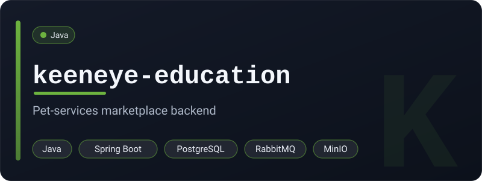
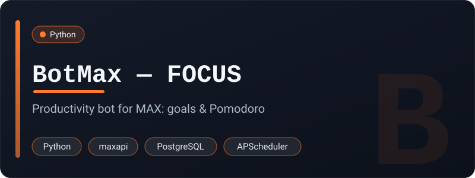
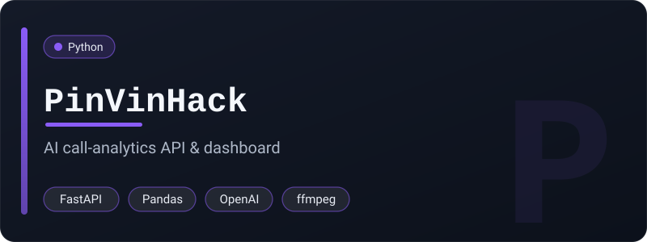
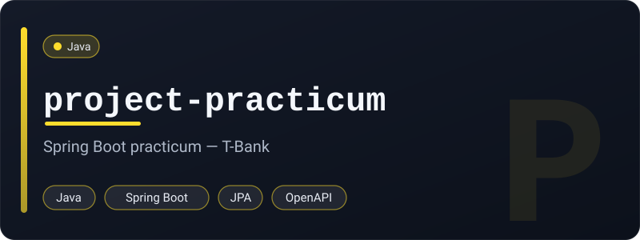
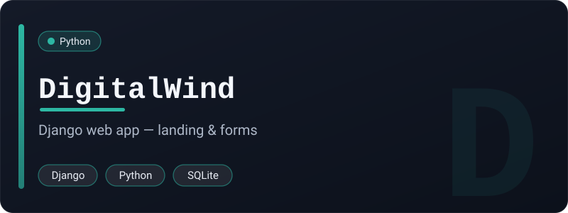

<h1 align="center">Hi there, I'm Ivan 👋</h1>

  

  

---

### 🧑‍💻 About me

- ☕ **Java backend developer** — I build services with **Spring Boot**
- ⚙️ Day-to-day: REST APIs, JWT auth, messaging (RabbitMQ), object storage (MinIO), real-time WebSocket chat
- 🗄️ Data layer: **PostgreSQL** with JPA / Hibernate
- 🐍 Also comfortable with **Python** (bots, parsers, Django) and picking up **Go**
- 🚀 DevOps-friendly: Docker, Linux, Nginx deployment
- 🎓 CS student · open to backend & freelance projects — ping me on Telegram

---

### 🧩 Featured Projects

<table>
  <tr>
    <td width="50%" valign="top">
      
      
Spring Boot backend for a pet-services marketplace — JWT auth, RabbitMQ events, MinIO file storage and a STOMP WebSocket chat.

    </td>
    <td width="50%" valign="top">
      
      
An HTTP proxy in Go built on clean architecture — rate limiting, IP allow/deny lists, response caching, Prometheus metrics and Swagger docs.

    </td>
  </tr>
  <tr>
    <td width="50%" valign="top">
      
      
FOCUS — a productivity bot for the MAX messenger: goal planning, a Pomodoro timer, habit tracking and smart reminders.

    </td>
    <td width="50%" valign="top">
      
      
Hackathon project — a FastAPI service that analyzes managers' sales calls with AI and serves reports through a web dashboard.

    </td>
  </tr>
  <tr>
    <td width="50%" valign="top">
      
      
A Spring Boot service from the T-Bank project practicum — REST API with JPA, validation, scheduling and OpenAPI docs.

    </td>
    <td width="50%" valign="top">
      
      
A Django web application — pages, templated forms and an admin, backed by the Django ORM.

    </td>
  </tr>
</table>

<a href="https://github.com/IvanZoizi?tab=repositories">→ browse all repositories</a>

---

### 🛠️ Tech Stack

**Languages**

**Backend & Frameworks**

**Databases & Messaging**

**DevOps & Tools**

---

### 📊 GitHub Stats

  
  

  

  

---

### 🌐 Connect with me

  

